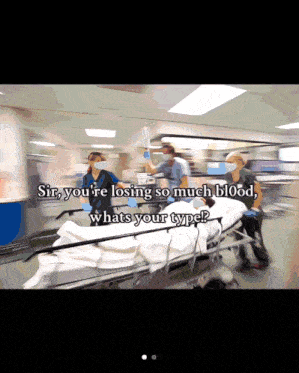

  

 

### 👋 Tentang Saya
- 🔭 Saat ini sedang mengerjakan proyek **[Fishing-Adventure](https://github.com/SanLierbert/Fishing-Adventure)**
- 🌱 Sedang mendalami **Web Development (HTML, CSS, JS)**
- 💬 Silakan tanya saya seputar **Web Dev atau Melers**
- ⚡ Fakta unik: *Lebih produktif ngoding sambil dengerin lagu JAWA*
- 📫 Kontak: **[emailkamu@example.com](mailto:emailkamu@example.com)**

 

---

### 🛠️ Bahasa & Tools yang Dikuasai

  
  
  
  
  

---

### 📊 Statistik GitHub

  
  
   
  

---

### 🌐 Terhubung dengan Saya

  
  

